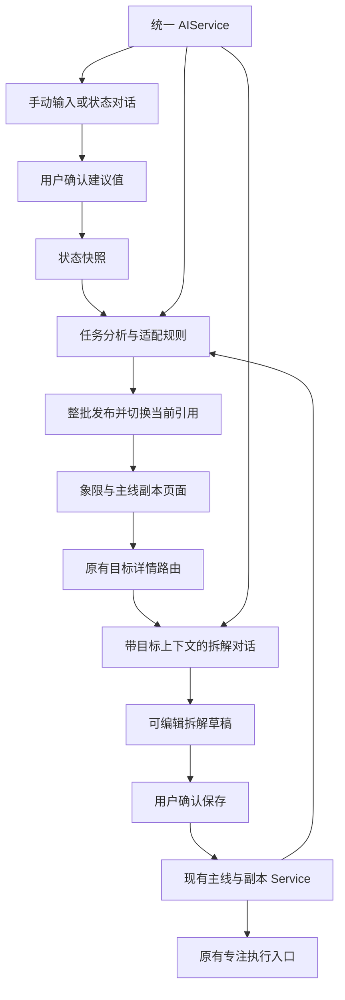

# V2.0 灵石区与启动状态：第 1 步架构设计

日期：2026-11-15（Asia/Shanghai）。状态：第 1 步设计交付，待用户验收；第 2–9 步未获实施批准。

本文件保留第 1 步交付时的设计与授权快照；当前实施状态以 PROGRESS.md 顶部为准。

用户以“开始第一步”批准前一轮提案。本次只修改文档，不新增业务代码、配置、依赖、数据库表或迁移，不调用模型、不部署。本文的接口、模型、规则和页面均为后续实施契约，不表示功能已经可用。

## 1. 基线、证据与缺口

检查基线为本地 Git 提交 `ff99ccb`（Implement stage 1.9 export and recovery），开始时工作区干净。本次检查源码与文档，没有连接数据库；应用期望迁移为 `0007_rewards`，此前在线执行记录见 [进度](PROGRESS.md) 和 [验收](ACCEPTANCE.md)。

| 范围 | 实际证据 | 复用与缺口 |
|---|---|---|
| 应用装配与导航 | [app/main.py](../app/main.py)、[base.html](../app/templates/base.html) | FastAPI、Jinja2、统一 PAGES 导航；尚无两个新入口，导航目前不渲染每项副标题 |
| 主题与移动布局 | [app.css](../app/static/css/app.css)、[app.js](../app/static/js/app.js) | 深浅主题、卡片、表单、移动导航；新增页面沿用组件，不引入 SPA |
| 身份 | [identity/service.py](../app/modules/identity/service.py)、[quests/router.py](../app/modules/quests/router.py) | 单用户注册、Argon2、数据库散列会话、归属查询、同源写入；公网登录限流、找回及代理加固未实现 |
| 主线与里程碑 | [quests/service.py](../app/modules/quests/service.py)、[quests/models.py](../app/modules/quests/models.py) | 查询、字段校验和进度可复用；创建、部分状态变更及历史写入仍在路由，后续按需提取服务 |
| 副本 | [tasks/service.py](../app/modules/tasks/service.py)、[tasks/models.py](../app/modules/tasks/models.py) | execute 支持用户锁、请求指纹、版本检查、事务内事件；只支持一层子任务，重复任务禁止子任务 |
| 执行与奖励 | [activity/router.py](../app/modules/activity/router.py)、[growth/service.py](../app/modules/growth/service.py) | 复用 /focus?task=UUID；计时、记录与奖励事实不由 AI 改写 |
| 导出 | [data_tools/service.py](../app/modules/data_tools/service.py) | 已有按用户导出白名单；新增私密数据不能直接加入通用逐字段导出 |
| 配置与安全日志 | [config.py](../app/core/config.py)、[logging.py](../app/core/logging.py) | 环境配置与脱敏基础可复用；没有模型 API 配置、加密主密钥或出站地址校验 |
| AI 与状态 | app 下模块、模型、路由的检查结果 | 尚无 AIService、模型适配器、状态快照、推荐、对话或拆解模型 |

现有副本有优先级和截止日期，没有预计时长、通用前置依赖关系；主线也没有优先级字段。查询契约中的缺失值为 null/unknown，不捏造为事实。AI 可提出估计，但必须标记来源并允许人工确认。

Task 有 version；MainQuest、Milestone 有 updated_at、没有整数版本。主线的子任务或里程碑变化不会可靠地反映为主线自身更新时间变化，所以缓存不能只依赖主线 updated_at。

历史文档中的“无业务表”“尚未认证”“数据库待配置”只代表早期阶段。实际已有 identity、quests、tasks、activity、growth、dashboard、data_tools。README 末尾及 AGENTS 的旧授权记录不代表新授权；以最新用户指令及 [PROGRESS](PROGRESS.md) 顶部为准。阶段 1 尚缺完整浏览器闭环、独立进程重启、手机真机及跨设备验收，不能因开始 V2 而补记为通过。

## 2. 模块边界与允许的依赖

保持 Python 模块化单体、SQLAlchemy 同步数据库服务、Alembic、服务端模板与少量浏览器 JavaScript。模块按实施步骤创建，当前不建空目录。

| 拟新增领域 | 责任 | 允许调用 | 不承担 |
|---|---|---|---|
| ai_gateway | 配置、加密、模型选择、Adapter、超时、结构校验、调用元数据 | 配置/身份基础设施、受控 HTTP 客户端 | 任务完成、奖励、自动保存正式任务 |
| startup_state | 状态校验、确认快照、四象限、当前发布引用 | 身份、数据库 | 自行推断未确认状态 |
| task_recommendation | 候选任务、特征缓存、人工修正、可解释规则、批次发布 | quests/tasks 公开查询、startup_state、AIService | 维护第二套任务事实 |
| startup_chat | 对话、状态建议、拆解草稿、多轮调整、确认用例 | AIService、状态/推荐查询、原有业务命令 | 任意执行模型返回的命令 |

用户身份取自 current_user；跨模块数据使用明确的只读 DTO（数据对象）及命令接口。查询服务不回传 ORM 对象给模型。必要的 same_origin/身份依赖可在第 2 步小范围移至公共安全辅助函数，保留旧路由行为及回归测试；不重构全部认证。

拟补齐 quests 的候选查询、上下文查询和确认后创建里程碑接口；tasks 复用 get_task、ensure_available、list_tasks、children、execute，增加批量只读上下文查询以避免逐项查库。quests/tasks 不反向依赖 AI Gateway，推荐信息由页面装配层读取。

## 3. 不变量与六条业务数据流

1. AI 输出只作为建议、特征或草稿；不得直接更改任务完成、删除、奖励或原计划。
2. 所有配置、状态、任务上下文、对话、批次和草稿均属于当前用户；客户端 user_id 不参与授权。
3. 当前推荐页面共享一个已发布 batch_id；该批次仅引用一个已确认 snapshot_id。未知、过期、不可用与白色“一般”分别展示。
4. 外部 AI 调用不在数据库事务或用户行锁内执行。模型请求前后使用短事务读取、复查和提交。
5. 正式任务保存必须经过用户明确确认，并复用旧模块的事务、归属、事件与幂等规则。
6. 模型密钥仅在服务端解密并用于经过验证的目标；不进入响应、页面、日志、LocalStorage 或普通导出。

| 流程 | 输入与权限 | 处理与落点 | 失败行为 |
|---|---|---|---|
| F1 对话 → 状态 | 本用户会话与新消息 | 提取 suggested_state；可编辑，确认后生成快照；只在发布后成为当前状态 | 信息不足短问；不把推断值当已确认事实 |
| F2 状态＋任务 → 评价 | 已确认数值、当前可用主线副本 | 真实候选快照 → 缓存特征/AI 分析 → 规则 → 待发布批次 | 非法结构或 ID 拒绝；不清空旧批次 |
| F3 评价 → 多页面 | 当前发布引用 | 一次读取 batch_id，整页读取其状态、关键词、颜色与说明 | 发现目标过期统一返回 stale；不拼接旧颜色与新关键词 |
| F4 关键词 → 详情 | 服务端生成 task_type 和 UUID | 验证后复用 /quests/{id} 或 /tasks/{id}；可携带来源批次用于提示 | 无效、删除、无权限均给可理解提示，不透露其他用户标题 |
| F5 拆解入口 → 对话 | 目标类型与 UUID | 重新读目标、主线、里程碑、已有子任务、当前状态；设置会话拆解模式 | 目标变化提示刷新上下文；无已确认状态时允许先手动输入 |
| F6 草稿 → 正式任务 | 用户选定步骤、草稿版本与确认编号 | 一个事务内检查版本和重复、创建合法业务对象、记录关联、提交 | 任一步失败整体回滚；相同确认返回既有结果 |

## 4. 统一 AI Gateway 契约与安全

### 4.1 配置和调用

第一版提供 OpenAI-compatible Chat Completions Adapter；这里指协议兼容，不承诺任意供应商全部能力一致。其他协议后续新增 Adapter，不在业务模块内分散调用。

AIService.generate(user_id, purpose, messages, output_schema, request_id, config_id=None) 为概念接口；选择顺序为用户明确指定、该模块绑定、用户默认配置。每一级均校验用户归属、启用状态和删除状态；指定配置不可用时返回明确错误，不静默换提供商。默认配置至多一个，删除/停用默认项后要求选择可用配置，不能随机使用其他入口。

配置保存自定义名称、规范化 Base URL、模型 ID、协议、手动到期日、备注、启用标记及配置版本。到期日为空即未填写；页面说明它是用户记录的日期，不能声称查到了供应商有效期。到期提醒与连接测试结果分开，是否可用以供应商实际响应为准。修改地址、协议、模型或 Key 后，原连接测试标记过期。

多轮输入只取当前模式必要上下文，明确 token/字符上限、消息截断和任务分页预算。结构化输出优先使用适配器支持的能力，最终始终由服务端 schema 校验；接口不支持 JSON 模式时可用受约束文本解析，无法校验就失败，不能伪造结构化成功。不给模型 SQL、任意工具或外部 URL 执行权。

AIResult 返回经校验内容、配置版本、模型、请求标识及可获得的 usage；用量缺失为 null，费用未知不得显示为 0。日志仅保存用途、时长、状态、安全错误类别和接口实际返回用量，不持久化模型隐式推理。完整消息只按对话业务需要保存在会话表，不写请求日志。

总超时、连接超时、响应大小、输出长度、并发调用和用户调用频率均有限制，第 2 步提案确定默认值。页面刷新不触发模型调用；连接测试使用固定短文本，不携带个人任务。发送后超时可能已计费，不自动重试或声称外部调用恰好一次；记录“结果未知”，用户主动重试使用新请求编号。默认不自动跨提供商回退。

### 4.2 密钥生命周期

采用经过维护的认证加密库，优先评估 Fernet/MultiFernet；第 2 步固定依赖并验证兼容性。数据库只存密文、密钥版本和可展示掩码；主密钥由服务器环境变量提供，开发时可由未跟踪的 .env 注入。缺失或解密失败时，AI 功能报配置错误，基础任务功能继续可用，绝不回退明文。

新增密钥通过密码输入框提交；编辑页面不回填旧密钥，留空保留，替换必须明确。接口查询仅返回 api_key_masked/has_key，不返回密文或明文。检查错误堆栈、HTTP 客户端调试日志、上游错误正文、表单验证错误、导出和 Git，避免间接泄露。改 Base URL 时提示密钥将发送到新目标，不静默触发连接测试。

轮换采用新写入用新钥、旧记录用带版本旧钥读取、受控重加密并验证后退役旧钥的流程；主密钥备份与数据库备份分开。丢失主密钥不能凭数据库恢复 API Key，需重新填写。配置删除清除可调用密文，历史调用仅留非敏感配置快照；不得因删除配置级联删除任务或对话事实。

### 4.3 Base URL 与浏览器安全

统一出站请求入口：规范化 URL；仅允许 HTTPS，不接受 userinfo、密钥查询参数、片段或非 HTTP 协议；端口和自定义域名遵守部署者可配置的目标政策。供应商路径只由 Adapter 拼接，不采纳模型生成的 URL。

请求前解析并检查全部 IPv4/IPv6 结果，拒绝回环、私有、链路本地、保留地址、云元数据地址及等价地址表示。禁止自动重定向；校验与实际连接必须绑定，保留原主机的 Host、SNI 和证书验证，防 DNS 重绑定。重试和备用连接使用相同限制；不能只保存配置时检查一次。环境代理不得悄悄绕过目标限制，受信代理需单独配置和验证。生产加出站网络限制，应用层校验不能代替网络策略。

新 API 必须认证、校验同源写入并限制请求体；配置、草稿、AI 内容显示使用转义的文本或受控渲染，禁止未经净化的 HTML。保留现有 CSP；新增脚本样式走本地静态资源。正式部署需要 HTTPS、安全 Cookie、可信代理/Host 配置、登录限流及数据库最小权限；本步不把本地基线标记为生产可用。

参考：[Fernet 官方文档](https://cryptography.io/en/latest/fernet/)；[OWASP SSRF 防护](https://cheatsheetseries.owasp.org/cheatsheets/Server_Side_Request_Forgery_Prevention_Cheat_Sheet.html)。技术策略是本项目设计，安全能力须在第 2 步通过实现与测试证明。

## 5. 状态、任务理解与跨页面一致性

### 5.1 状态及界面

压力、能量为 0–100 的整数，0、50、100 都是有效边界；低为 <50，高为 >=50。横轴压力左低右高，纵轴能量下低上高：

| 压力 | 能量 | 象限 | 行动策略 |
|---|---|---|---|
| <50 | >=50 | 投入区 | 推进明确而需要专注的行动 |
| >=50 | >=50 | 降噪区 | 降低混乱，选一个重点 |
| <50 | <50 | 激活区 | 轻量、有反馈的尝试 |
| >=50 | <50 | 修复区 | 休息、减负或最小行动 |

(50,50) 属于降噪区；(0,0) 属于激活区；(100,100) 属于降噪区。这是行动辅助划分，不是医学诊断；修复区不表示失败，始终允许休息与自主选择。

桌面主内容区按约 3:1 分配象限与对话，保留现有侧栏；窄屏按象限、对话纵向排列，输入和主要按钮适合触屏。圆点和任务关键词提供可读文字、键盘操作和焦点提示，不仅靠颜色表达。使用 SVG/普通页面组件与本地脚本即可；四象限标签须换行、限制密度并提供更多列表，不能截断到无法选择目标。

AI 输出 suggested_state 明确显示“建议值”；人工修改、点击确认后才允许刷新，修改已确认的输入将撤销本轮确认。后端同样校验确认标识和输入版本。信息充足不重复追问，信息不足只补必要内容。用户在拆解对话中提及新压力/能量时仅生成待确认建议，不静默覆盖当前状态。

第 4 步支持只保存手动状态并显示状态点；此时 current_batch_id 为空。第 5 步以后若选择“仅保存手动状态”，必须在同一事务清空当前批次引用并展示“未评估”，旧批次仅作历史，不能套用旧颜色。普通 AI 刷新失败不触发这个分支。

手动保存同样检查当前发布版本并增加 generation，使之前仍在计算的刷新失效；重复 request_id 返回原保存结果，不再递增代次。不同内容重用编号返回 409。这样手动确认后，早先启动的模型请求不能晚到并覆盖新状态。

### 5.2 候选任务、特征和评价

默认自动推荐 active、未删除主线，以及 todo/in_progress、未删除且关联可用的副本。关联暂停/已完成/归档主线的任务不进入自动推荐，用户仍可在原页面自主查看和操作；独立副本可参加。过滤父任务/里程碑删除等间接不可用情况。已完成或暂停对象可查看历史和讨论拆解，但不能绕过原服务保存限制。

TaskContext 包含 task_type、真实 ID、标题、描述、业务状态、可用的优先级/截止日、主线/里程碑/父子结构、真实进度、版本指纹和缺失字段标识。当前子任务关系不是通用前置依赖图；AI 推断的依赖或时长必须标记“估计/待确认”，不伪造为数据库事实。

TaskFeatures 包含短关键词、主题、启动门槛、精力需求、复杂度、阻力、下一步是否明确、可拆最小动作、适用象限集合，以及字段来源和待确认项。一个任务可以属于多个象限，所有标签都引用同一真实对象。没有真实对象的即时建议单独显示“临时建议”，不生成伪造详情链接。

规则输入为状态、困难和可用特征，输出 level、reason_codes、自然语言理由及适用象限。颜色表达执行适配：green 推荐、white 一般、yellow 不太推荐、red 很不推荐；未评估用 level=null 和 assessment_status，不强行归入白色。不阻止用户执行红色任务。

规则顺序先检查数据完整性，再判断精力/负荷不匹配、启动阻力/下一步清晰度，最后得到适配等级。优先级、截止日和紧急性提示影响排序，不能直接覆盖颜色。可用行动中再按适配、紧急性和优先级稳定排序，以 ID 作最终稳定排序键。数值阈值属于内部规则；第 5 步提案冻结 rule_version 与边界用例，不声称科学测量。自然语言建议只能引用本批次实际结果，不能另起一套相反评价。

### 5.3 缓存与人工修正

特征缓存键包括用户、目标类型/ID、规范化内容指纹、分析协议/提示词版本和模型配置版本。任务指纹包含自身业务字段、Task.version，以及相关主线、里程碑、父任务和子任务的有效结构；主线指纹包含里程碑和关联任务摘要，不只取 updated_at。时间接近截止日会改变排序，查询时依据用户时区的当前日期标记排序有效性，不能缓存无限期的“今天”。

人工修正保存适用象限、关键词或特征覆盖、原因与更新时间，不静默改写原任务；覆盖也绑定内容指纹。AI 重分析不能覆盖仍有效的人工确认。目标内容变化后保留旧覆盖作历史、提示重新确认，不自动沿用可能过时的结论。

只在任务变化、人工主动重分析、特征过期或相关分析配置变化时重新请求模型。只改压力/能量时复用有效特征，用规则重新计算；第 7 步显式刷新可再请求短建议，不能重复发送全部历史。GET 页面不发模型请求。批量处理限制任务数和文本量，超出范围显示“尚未分析”，不能假装覆盖全部任务；具体默认上限在第 5 步提案中确定。

### 5.4 推荐批次发布协议

1. 认证并验证已确认输入；短事务锁定本用户的 startup_current 行，分配 generation，按 request_id 去重，记录候选快照和 building 批次。新旧任务集合均需有指纹。提交后释放连接和锁。
2. 在事务外读取/生成任务特征、计算所有结果、验证模型结构和允许引用的任务集合。未评估项作为明确结果保存，不因解析失败猜测颜色。正常刷新发生关键 AI 错误时终止本次批次。
3. 发布短事务使用与原写入一致的用户锁及固定锁顺序，复查身份、配置版本、当前 generation 和候选集合/内容指纹；新建、删除、关联变化同样算冲突。为使集合检查可靠，第 5 步需补齐主线创建等参与写入路径的同用户锁，保持原行为。
4. 校验通过后，在同一事务保存结果、标记批次 published，并把 current_snapshot_id 和 current_batch_id 一起切换。全部成功或全部回滚。较早请求即使最后返回也不得覆盖更新 generation；冲突返回 409，保留旧当前值，等待用户重试。
5. 请求重试返回同一已发布结果；building 请求返回处理中状态。进程中断后的超时 building 批次可由下次请求标记失败，不依赖后台队列，不自动重复计费请求。用户显式重试生成新编号。

批次状态为 building/published/failed/superseded；失败可以保留受控错误类别，但不能成为当前批次。失败后页面保留上次状态点、批次及时间，当前输入留作草稿，并提示重试。没有旧批次时显示空状态。无 AI 配置时仍可保存手动状态、使用基础任务功能；显式选择基础规则刷新时，可用有效缓存计算，缺失项标“待确认”，整个批次注明 rules_only，不冒充 AI 分析成功。

get_current_view(user_id) 在同一读取快照中获取当前引用、状态和批次结果，输出 batch_id、snapshot_id、发布版本、计算时间、来源及每项 freshness。所有页面调用它；不按每个任务单独查“最新一条”。任务变化后在新请求中统一呈现“已过期，待刷新”而不是保留当前色，已删除/无权限对象不显示为可点击推荐。规则/配置更新使相关结果过期，旧记录仍可追踪。

已打开页面在恢复可见、窗口聚焦及轻量定时检查时读取版本；检测到批次或目标有效性变化，统一更新整个推荐区域或隐藏旧推荐并提示刷新。检查间隔在第 6 步确定。离线或检查失败展示最后校验时间及“可能已过期”，不承诺所有设备屏幕物理上瞬时同步。来源链接可携带 batch_id，但详情页仍显示当前批次；已变更时提示来源推荐过期。

## 6. 跨页面任务定位与拆解保存

### 6.1 入口和会话

主线/副本列表及详情均提供颜色文字、理由和拆解入口。按钮是否可点击不依赖颜色；已完成/已删除等对象允许给出解释性页面，不绕过业务保存限制。URL 只带 task_type=quest/task、task_id=UUID 和可选来源 batch_id，完整上下文通过后端归属检查后读取，不接收前端提交的任意任务正文作为事实。

使用 /startup?task_type=task&task_id=UUID#chat 定位右侧对话；主线将 task_type 改为 quest。页面加载只读取信息，GET 不创建正式任务、不消耗模型额度。第 6 步显示已选目标和功能待接入说明；第 8 步用户点击拆解入口后，由页面显式 POST 启动本轮生成，并使用本次操作编号防止双击；刷新、浏览器后退或预加载不重新生成。必要上下文保存为会话目标，用户切换目标时新建/明确切换会话，不混入另一任务的拆解消息。

进入、发送消息、生成草稿、确认保存四个边界都复查目标存在、归属、删除和关联状态。无法访问统一提示“目标已变化或不可访问”，提供返回列表入口，不回显其他用户内容。目标内容变化时展示新旧上下文差异或要求重新载入，不能按旧描述继续静默保存。

### 6.2 草稿结构与不同任务策略

BreakdownDraft 包含原任务引用/内容指纹、状态快照/推荐批次、模式、草稿版本、选定配置版本、steps、minimum_action、warnings。步骤使用稳定 step_id，每步含行动标题、可编辑说明、预计分钟数（估计）、完成标志、拟保存类型和可复用的现有任务引用。通常 3–5 步，简单任务允许 1–2 步；数量、文本和耗时范围由 schema 限制，不接受无限拆解。

主线优先利用已有里程碑和副本，提出阶段目标/可交付成果、必要新副本及当前第一步；不建立第二套主线。普通副本优先短步骤和最小动作，不把所有步骤必然转为正式任务。已有子任务、重复任务或已完成任务也可获得讨论建议，但不能偷偷改变其结构规则。

用户可以继续反馈“再小一点”“只有十分钟”等，AI 在当前任务与已确认状态范围内调整；新结果为草稿新版本。用户编辑保留作者来源；重新生成不会覆盖已确认正式任务。模型提出新压力/能量只生成确认提示，确认刷新后，当前草稿标记状态上下文已变化，允许重新生成或明确保留旧方案。

未确认草稿可以原地编辑并递增 revision；编辑/重新生成都检查原 revision，迟到的 AI 结果不能覆盖用户刚改的草稿。已确认计划不得回到 draft；重新生成时创建新 plan_id 并关联上一计划，原确认记录和正式对象映射保留。已确认清单只允许更新独立的 checklist_version、勾选状态及操作记录，不修改已确认步骤正文或再触发创建。会话消息同样使用请求号和版本保护，旧回复不能切换当前目标或覆盖较新的状态建议。

### 6.3 确认、去重和事务

“接受并保存”页面预览所选步骤及目标位置，用户可取消部分步骤、修改文本并选择保存方式。保存策略如下：

| 目标 | 合法落点 | 执行关联 |
|---|---|---|
| 可用主线 | 用户选定的里程碑、关联副本，或仅行动清单 | 选择已有副本或确认新建一项后进入专注 |
| 未完成、非重复根副本 | 一层子任务或关联行动清单 | 已保存子任务或原副本 |
| 已是一层子任务 | 关联行动清单；不生成孙任务 | 当前子任务 |
| 重复副本 | 关联行动清单；不改变重复规则、不生成子任务 | 当前这期副本，清单不自动继承给下一期 |
| 已完成、删除或关联不可用对象 | 可查看历史；保存需先在原页面处理状态 | 不自动撤销完成、恢复、重开或启动 |

行动清单保存在已确认的拆解计划内，有稳定步骤 ID 和可追踪的勾选状态；它是辅助步骤，不是新副本，不计入任务进度、经验或金币。普通任务描述不被清单覆盖。若未来需要从清单转任务，仍须显式确认并调用原业务服务。

确认事务先按统一顺序锁用户和计划，检查计划归属、expected_revision、当前状态及目标内容指纹，校验所有拟复用对象。然后一次性创建全部选定正式对象，保存 step_id 到真实对象 ID 的映射、确认时间和提交指纹，并标记该版本已确认。任务创建使用 tasks.execute 的幂等命令，里程碑创建调用提取后的 quests 服务，二者共享外层事务；任一失败全部回滚。

同一计划版本重复确认，包括换 request_id 的双击，都返回已确认映射；携带不同内容重用编号返回 409。每一步有稳定命令标识，确认完成后不可通过编辑同一版本再次创建；需显式新草稿。计划记录版本和数据库唯一约束共同保证，不只禁用按钮。

不同草稿可能产生同名步骤：保存前比较本目标已有子任务/清单和关联映射，提示相似项并默认建议复用或取消；确实需要重复时用户明确选择。不能全局禁止同名合法任务，也不能把换草稿当绕过重复提示的方式。相似性提示和精确幂等分别处理。

“开始第一步”复用 /focus?task=真实UUID，再通过现有开始操作创建计时；任务未保存时可选择在原副本下执行清单动作。主线本身没有副本执行 ID，必须选择已有副本或确认创建最小副本，不能伪造 ID。跳转和刷新象限都不自动标记完成、开始计时或发放奖励。

## 7. 数据模型与迁移计划（尚未实施）

以下为逻辑表名和最低字段契约；具体长度、索引和迁移文件名在对应步骤冻结。所有业务表带 user_id；时间为 UTC timestamptz，日期按用户时区显示；可变记录有版本和 updated_at，历史快照及已发布结果不可原地覆盖。

| 表 | 最低字段 | 约束/用途 | 首次步骤 |
|---|---|---|---|
| ai_configs | id、user_id、create_request_id、create_fingerprint、name、base_url、protocol、model_id、encrypted_key、key_version、key_mask、expires_on、enabled、is_default、notes、config_version、last_test_version/result/time、deleted_at | (id,user_id) 与 (user_id,create_request_id) 各唯一；每用户至多一默认，默认必须启用且未删除；删除清除密文 | 2 |
| ai_module_bindings | user_id、module_key、config_id | (user_id,module_key) 唯一；配置归属复合外键；模块枚举白名单 | 2 |
| ai_call_logs | id、user_id、config_id 可空、配置/模型非敏感快照、purpose、request_id、请求指纹、status、started_at、finished_at、usage 可空、安全错误码 | (user_id,purpose,request_id) 唯一；无密钥/原始提示词/原始异常；配置删除保留元数据 | 2 |
| startup_state_snapshots | id、user_id、request_id、request_fingerprint、pressure、energy、difficulty、source、confirmed_at、created_at | (user_id,request_id) 唯一；数值 0–100；source=manual/ai_confirmed；保存历史不等于成为当前 | 4 |
| startup_current | user_id 主键、current_snapshot_id、current_batch_id、generation、updated_at | 同用户引用；第 4 步仅状态引用，第 5 步增加批次/代次；有批次时其 snapshot 必须匹配当前状态 | 4/5 |
| task_analysis_cache | id、user_id、target 引用、content_fingerprint、config_version、analysis_version、features_json、manual_override_json、override_version、created_at、updated_at | 特征来源与待确认信息分开；按目标和分析版本建立唯一键；旧指纹结果不得当当前缓存 | 5 |
| recommendation_batches | id、user_id、snapshot_id、generation、request_id、request_fingerprint、candidate_fingerprint、rule_version、analysis_context、source、status、summary、created_at、published_at | 请求唯一；source=ai_assisted/rules_only；当前引用只能指向本用户 published 批次 | 5 |
| recommendation_items | id、user_id、batch_id、target 引用、content_fingerprint、feature/override版本、assessment_status、level 可空、reason_codes、reason、keywords/quadrants、排序依据 | 每批次每目标唯一；level 仅四种，未评估为空；保留批次计算时的解释，关键词可多象限 | 5 |
| startup_conversations | id、user_id、mode、target 引用可空、context_fingerprint、snapshot_id、batch_id、version、created_at、updated_at | mode=state/breakdown；拆解模式必须有一个合法目标 | 7 |
| startup_messages | id、user_id、conversation_id、request_id、role、content、suggested_state_json、created_at | 同用户会话外键；允许角色固定；请求＋回复序号去重，不接受客户端伪造 system 角色 | 7 |
| breakdown_plans | id、user_id、conversation_id、previous_plan_id 可空、target 引用、context_fingerprint、snapshot_id、batch_id、revision、status、steps_json、minimum_action_json、confirmation_fingerprint、confirmed_at、saved_mapping_json、checklist_version/state/events | 同计划版本只确认一次；draft/confirmed/superseded 区分；确认后重生成新 plan_id；步骤含稳定 ID，正式任务关联须校验同用户 | 8 |

target 引用采用 quest_id 与 task_id 两个可空列并用 CHECK 保证恰有一个；类型由非空列推导，对外仍用 task_type + task_id。以 (目标ID,user_id) 复合外键保证归属；state 模式会话允许两者均空。PostgreSQL 对 nullable 列的唯一性不能直接当防重保障，分别为 quest/task 建部分唯一索引或等效非空键。

batch 与 snapshot、conversation 与 message、plan 与 conversation 都需同用户复合外键；startup_current 有批次时使用包含 snapshot_id 的组合约束保证匹配，发布状态由事务服务检查。JSON 内的外部任务引用由服务端逐项验证；保存映射与原任务创建在同一事务，重要唯一性落数据库，不以 JSON 检查替代。

迁移顺序：第 2 步配置/调用表 → 第 4 步状态表 → 第 5 步分析/批次表并扩展 current → 第 7 步会话表 → 第 8 步计划表。第 6 步不重复建立推荐表，可按已批准需要补充字段。每步同步 ORM 注册、Alembic、应用 EXPECTED_REVISION；不在启动时自动迁移，不提前编号声称已执行。

迁移在显式测试连接的临时隔离 schema 验证升级、约束和可行的降级，再按获批步骤迁移开发库。降级可能删除 AI 数据，不视为恢复方案，真实库降级另行评估备份。原 tasks/main_quests 不添加永久颜色字段，不改变现有完成/奖励事实。

导出策略：普通数据导出永不包含主密钥、API Key 明文/密文、登录会话或原始网络日志。第 9 步扩展导出格式版本并使用显式字段白名单；状态、对话、草稿和确认记录作为用户明确选择的私密内容导出，配置只可导出无凭据元数据。仍不承诺 ZIP 自动导入，数据库备份与主密钥备份独立管理。保留期限和对话删除 UI 属后续明确范围；本轮不擅自批量清理历史。

## 8. 页面、HTTP API 与内部接口（尚未实施）

### 8.1 页面与 HTTP 契约

页面路由与已有 PAGES 导航规则兼容：新增 spirit-stones、startup 两项及副标题显示。保持原主线、副本和专注 URL，以下 /api 路由是新增 JSON 接口草案。

| 方法与路径 | 关键输入/输出 | 写入/外部调用 | 步骤 |
|---|---|---|---|
| GET /spirit-stones | 卡片、到期提示、默认与最近测试状态；密钥仅掩码 | 无 | 3 |
| GET /api/ai/configs；GET /api/ai/configs/{id} | 仅本用户脱敏配置、config_version | 无 | 2 |
| POST /api/ai/configs | 配置字段、write-only API Key、request_id | 加密入库，不自动测试 | 2 |
| PATCH /api/ai/configs/{id} | expected_version；空密钥保留、明确替换 | 版本校验、旧测试失效；无外部请求 | 2 |
| DELETE /api/ai/configs/{id} | expected_version | 清除密钥与绑定、保留调用元数据 | 2 |
| POST /api/ai/configs/{id}/default | expected_version | 同用户事务切换唯一默认 | 2 |
| POST /api/ai/configs/{id}/test | request_id、expected_version | 固定短文本的真实调用；返回脱敏结果与实际用量 | 2 |
| PUT /api/ai/module-bindings/{module} | 本用户 config_id 或 null | 设置模块模型或回到默认 | 2 |
| GET /startup | 可选 task_type、task_id、来源 batch_id | 只读状态与上下文，不发模型请求 | 4；目标入口 6 |
| GET /api/startup/current | 当前状态、整批结果、版本、有效性与时间 | 无，页面一致性检查复用 | 4/5 |
| POST /api/startup/states | confirmed=true、压力/能量/困难、request_id、当前发布版本 | 手动保存状态；第 5 步起原子清空旧 current_batch_id | 4 |
| POST /api/startup/refresh | 确认的输入版本、request_id、expected_generation、mode | 准备/校验/发布批次；按缓存和模式调用 AI | 5；对话确认接入 7 |
| PATCH /api/startup/task-analyses/{id} | expected_version、人工修正及原因 | 保存覆盖并标记当前相关评价过期，不隐式发 AI 请求 | 5 |
| POST /api/startup/conversations | mode、目标引用可选 | 创建本用户会话，不生成正式任务 | 7 |
| POST /api/startup/conversations/{id}/messages | 消息、request_id、expected_version | 保存消息与已校验回复/状态建议 | 7 |
| POST /api/startup/breakdowns | 目标、conversation_id、request_id、expected_context | 加载真实上下文并生成草稿 | 8 |
| PATCH /api/startup/breakdowns/{id} | expected_revision、编辑步骤；清单另校验 expected_checklist_version | 草稿编辑；确认后只允许清单操作，不修改正式任务 | 8 |
| POST /api/startup/breakdowns/{id}/regenerate | expected_revision、用户反馈、request_id | 未确认生成新草稿版本；已确认返回新 plan_id，不覆盖已保存任务 | 8 |
| POST /api/startup/breakdowns/{id}/confirm | expected_revision、selected_steps、save_mode、重复处理选择、request_id | 原业务服务保存并返回真实 ID 映射；不调用 AI | 8 |

enable/disable 通过配置 PATCH，不另造状态接口。第 5 步可提供显式重新分析选项并复用 refresh 的请求契约，第 7 步补充状态对话确认，不让各页面自行调用模型。人工修正后显示“待刷新”，重新刷新时才发布与新覆盖一致的批次。

身份缺失 JSON 返回 401，页面进入账号入口；跨来源写入 403；目标不存在/无权统一 404；输入不合法 422；版本冲突或上下文过期 409；频率限制 429；可恢复上游错误 502/504，配置不可用返回受控错误码。错误正文只含安全文案、类别和 request_id，不回显密钥、数据库参数或供应商原始异常。具体错误码与前端文案在对应步骤测试中固定。

### 8.2 内部公开接口

| 概念接口 | 输入与返回 | 所属/首次步骤 |
|---|---|---|
| AIService.generate / test_connection | 用户、用途、配置选择、消息、schema、请求号 → 校验后结果/受控错误 | ai_gateway / 2 |
| StateService.confirm_manual / locate | 数值与来源 → 合法快照/象限 | startup_state / 4 |
| QuestQuery/TaskQuery.list_candidates / get_context | 用户、目标引用 → 只读 DTO、可用性、指纹 | 原领域服务 / 5 |
| RecommendationService.refresh / get_current_view | 确认状态或用户 → 统一批次/整页视图 | task_recommendation / 5 |
| AnalysisService.correct / invalidate | 用户、目标指纹、人工覆盖 → 新覆盖版本 | task_recommendation / 5 |
| StartupChatService.send | 用户、会话、消息、版本 → 回复和待确认状态 | startup_chat / 7 |
| BreakdownService.generate / confirm | 真实上下文或已编辑计划 → 草稿或正式对象映射 | startup_chat / 8 |
| QuestService.create_milestone；tasks.execute | 本用户、合法业务输入、共享 Session → 真实对象 | quests 按需提取 / 8；tasks 已有 |

未来主线生成、角色设定、飞轮复盘均调用 AIService，并注册用途和可发送数据范围；不得复制密钥存储与客户端。业务调用不能把 provider 原始响应直接当正式任务命令，长期上下文由对应业务管理。

## 9. 九步开发依赖与每步验收

九步保持用户指定顺序；第 4 步技术上能独立于 AI 运行，不代表可以跳过审批并行开发。唯一依赖细化是将第 6 步所需推荐存储的最小结构放在第 5 步建立，避免第 5 步保存分类却没有统一批次。每步须先提案、获批后实施、测试、更新文档并停止。

| 步骤 | 范围与依赖 | 交付验收 | 不提前做 |
|---|---|---|---|
| 1 | 当前基线检查、本文及六份文档整理 | 架构、模型、接口、六条数据流、风险与测试计划可追溯 | 业务代码、迁移、模型调用 |
| 2 | 依赖 1；AI Gateway 后端、加密、配置 CRUD、绑定、测试、日志 | 安全接口管理多配置；真实连接成功/失败可区分；密钥不泄露 | 灵石区网页、任务分析 |
| 3 | 依赖 2；灵石区导航、列表、编辑、默认、到期提示和测试反馈 | 网页保存后重新打开一致，启停/删除/默认正确，密码框不回填 | 状态页面 |
| 4 | 依赖 1 的状态契约；手动状态、坐标、快照、响应式、聊天占位 | 0/50/100 等边界正确；刷新后状态保留 | AI 对话、任务分类、四色评价 |
| 5 | 依赖 2、4；真实任务查询、特征缓存、人工修正、基础批次、关键词/跳转 | 无伪造目标，失效可见；失败不混用结果；批次包含基础四色评价供后续复用 | 主线/副本颜色 UI、完整聊天 |
| 6 | 依赖 5；四处颜色/理由/拆解入口、旧页面版本检查、目标上下文 | 列表和详情与象限同批次；正确跳到目标拆解占位区 | AI 拆解生成 |
| 7 | 依赖 2、4–6；多轮状态理解、确认、刷新、建议和会话历史 | 自然描述→确认→刷新；相关页面显示同批结果；失败可重试 | 正式拆解保存 |
| 8 | 依赖 6、7；区别主线/副本策略、编辑/重生成、清单/任务确认、执行联动 | 从原任务进入，生成低阻力计划，确认保存一次，返回并开始执行 | 自动完成、自动奖励、无限子任务 |
| 9 | 依赖 2–8；整体联调、异常与回归、导出范围、交付说明 | 完整浏览器闭环、独立进程重启、数据隔离与持久化；实机结果单列 | 未批准的公网发布、其他阶段功能 |

与 V1 路线对应：V2 第 2–3 步承接原 2.1；第 8 步承接原 2.2；第 7 步仅覆盖原 2.6 的启动状态对话子集。原自评/角色身份卡、SPRINT、飞轮复盘、通用 AI 对话及阶段 3–5 仍单独保留，不因 V2 设计而记为完成。

每步文件落点在获批提案中列明：模块按需建 models/service/schemas/router/adapter 等实际文件；页面复用现有模板布局与本地 CSS/JS；不机械建立 repository 等空壳。ORM 新表必须有迁移和对应约束测试。

## 10. 测试矩阵与最终验收闭环

本节全部是后续测试计划，不是本次测试通过记录。数据库测试使用显式 TEST_DATABASE_URL；同一 Supabase 项目内临时 schema 与独立测试项目必须在报告中区分。默认跳过项不能算通过。供应商模拟测试与真实连接测试分开报告。

| 编号 | 对象与场景 | 必须观察到的结果 | 步骤 |
|---|---|---|---|
| V2-T01 | 多 API CRUD、同时设默认、停用/删除默认、模块绑定 | 至多一个可用默认；绑定不跨用户，不静默切供应商 | 2/3 |
| V2-T02 | 密钥入库、查询、错误、日志、导出、主密钥缺失/轮换 | 密文可验证解密；无明文泄露；配置错误不影响基础任务 | 2/9 |
| V2-T03 | 内网/回环/元数据、IPv6、别名、重定向、DNS 重绑定、代理 | 所有出站路径执行同一目标校验，重试不能绕过 | 2 |
| V2-T04 | 无会话、跨用户配置/任务/会话/批次/草稿、伪造 user_id、跨来源写入 | 服务拒绝并不泄露目标内容；数据库拒绝跨用户关联 | 各步/9 |
| V2-T05 | 真实连接、无效密钥/模型、超时、429、上游故障、不支持 JSON | 安全文案；失败不假装成功；未知计费不自动重试 | 2/3/9 |
| V2-T06 | 缺失/异常 usage、修改配置、恶意回复 HTML | 缺失为未知；测试结果失效；输出安全渲染 | 2/3/7 |
| V2-T07 | 压力/能量 0/49/50/100、越界、缺失、坐标方向 | 象限规则正确；无确认不保存；刷新后持久化 | 4 |
| V2-T08 | 桌面 3:1、窄屏、键盘、深浅主题、长标签、多任务 | 不遮挡主要按钮；颜色含文字解释；任务可定位 | 3–9 |
| V2-T09 | 真主线/副本、多象限标签、未知时长/依赖、暂停/删除关联 | 只显示允许的真实候选；未知信息标待确认 | 5 |
| V2-T10 | 虚构 ID、错误类型、跨用户 ID、JSON 畸形/超长、提示词注入 | 严格校验拒绝；模型不能绕过权限或触发业务命令 | 5/7/8 |
| V2-T11 | 压力变化、任务变化、子任务/里程碑变化、模型变化、人工覆盖 | 有效特征复用；失效能识别；不偷偷覆盖人工确认 | 5 |
| V2-T12 | 低能量高负荷、高压力不明确、缺信息、高优先级/逾期 | 阈值边界可解释；紧急性不能无条件标绿；未评估不当白色 | 5/6 |
| V2-T13 | 批次中途失败、发布事务异常、模型格式错误 | 当前状态和批次保持旧值；无半批结果 | 5/7 |
| V2-T14 | 同时刷新、旧请求晚到、重复提交、任务在计算时被新增/删除/修改 | 旧代次不能覆盖新代次；冲突可重试；相同请求幂等 | 5/7 |
| V2-T15 | 象限、主线/副本列表和详情、另开标签页、离线页面 | 服务端同批次；旧屏幕检测变更或明确过期，不能无提示矛盾 | 6/7 |
| V2-T16 | 完整/不足状态描述、AI 建议、手动改值、拆解中改变状态 | 必要追问；人工确认；改变输入撤销确认；不静默改当前状态 | 7 |
| V2-T17 | AI 失败、无配置、只保存状态、基础规则模式 | 基础功能可用；正常失败保留旧批次；手动新状态不配旧色 | 4–7 |
| V2-T18 | 主线/副本四处拆解入口、非法 ID、目标删除、切换任务 | 精确加载目标并定位聊天；GET 不产生费用；上下文不串任务 | 6/8 |
| V2-T19 | 主线、普通副本、子任务、重复副本、已有里程碑/子任务 | 使用不同策略与合法落点，不生成孙任务/重复内容 | 8 |
| V2-T20 | 再拆小、限时、编辑、重生成、改变状态、返回再进入 | 保留上下文和版本；展示最小动作/耗时估计/完成标志 | 8 |
| V2-T21 | 未确认、同编号/不同编号重复确认、并发确认、换草稿同名步骤 | 未确认不建正式任务；同版本一次保存；相似项明确处理 | 8 |
| V2-T22 | 保存中业务失败、跨用户现有步骤、任务/草稿已变化 | 正式对象、映射与确认状态全部回滚或拒绝 | 8 |
| V2-T23 | 清单勾选、从第一步开始、任务完成/撤销、重复副本下一期 | 清单不发奖励；执行走旧入口；原奖励/重复规则保持 | 8/9 |
| V2-T24 | 新连接、新应用实例、独立进程重启、正常/失败历史 | 区分三类持久化证据；所有已提交状态可重读 | 各步/9 |
| V2-T25 | 迁移升级/约束/适用降级、数据导出白名单与私密选项 | 数据结构与 ORM 一致；新旧凭据不被导出 | 各步/9 |
| V2-T26 | 原登录、主线、里程碑、副本、计时、手记、奖励、首页、恢复 | 旧业务及隔离/事务回归通过；跳过和未测如实列出 | 相关步/9 |

第 9 步核心人工/浏览器验收：登录 → 灵石区配置与连接测试 → 描述状态 → 修改并确认 → 刷新象限 → 核对主线/副本同批颜色 → 点击真实关键词进详情 → 点击拆解返回对应上下文 → 多轮降低启动门槛 → 编辑并确认部分步骤 → 重复提交不重复创建 → 进入专注 → 结束产生手记 → 完成任务奖励正确 → 重启服务重读数据。另测 AI 中断后旧状态可见、目标删除/权限变化、手机宽度；手机真机与跨设备需有实际设备/可达环境，不能用模拟器代替并宣称通过。

## 11. 风险、依赖和待冻结项

| 风险/依赖 | 设计处理 | 最迟解决 |
|---|---|---|
| 旧文档混杂历史与当前 | 当前摘要明确源码基线与未测项，保留历史证据 | 本步 |
| 供应商与真实模型凭据尚未选择 | 第 2 步前确定协议、端点和测试配置；数据库凭据不是模型凭据 | 2 真实验收前 |
| 主密钥及 SSRF 实际连接实现 | 审核 HTTP 客户端能力、冻结目标政策、加密与网络攻击测试 | 2 |
| 认证公网能力不足 | 本地会话继续复用；生产 HTTPS/代理/限流与最小权限另行验收 | 公网部署前 |
| 任务缺时长/依赖、主线缺优先级/整数版本 | 明确 unknown/估计来源，内容与结构指纹，不臆造业务字段 | 5 |
| 第 5/6 步存储依赖倒置 | 第 5 步建统一批次及基础颜色计算，第 6 步接页面 | 5 |
| 模型慢调用、并发覆盖、崩溃后重试 | 短事务、持久化代次/幂等记录、失败保留、主动重试 | 2/5/7 |
| 推荐阈值/排序、缓存过期上限与分析预算 | 第 5 步提案冻结规则、数量上限和边界测试，不包装为科学评分 | 5 |
| 多标签页旧 UI、轮询成本 | 统一版本和目标有效性检查；第 6 步确定间隔，离线明确提示 | 6 |
| 部分主线写入仍在路由 | 提取必要查询与创建服务，补参与集合并发校验的锁路径 | 5/8 |
| 拆解与一层/重复限制冲突 | 行动清单和合法正式对象分开；确认前展示保存位置 | 8 |
| 个人状态/聊天发送与导出范围 | 只传当前任务/会话必要字段；配置及首次使用说明发送范围；私密导出显式选择 | 3/7/9 |
| 阶段 1 浏览器与重启验收缺口 | 相关步骤做回归，最终完整链路单独记录，不借设计完成补记通过 | 9 |

以上待冻结项不阻止本步设计交付，也不代表未来步骤可跳过批准。下一步提案须列清凭据输入方式、真实调用范围、可能费用、实现文件和测试条件；本步不向用户索要密钥，不读取或修改 .env。

## 12. 本步交付、验收与停止点

本步交付为本文及 ROADMAP、ARCHITECTURE、DATA_MODEL、PROGRESS、DECISIONS、ACCEPTANCE 六份文档更新。已有业务源文件、依赖、配置、迁移和数据不变；因此没有新的启动命令或可操作页面，阅读本文即可验收设计。

文档检查项：七文件变更边界、Markdown 本地链接存在、表格列数和代码围栏配对、九步依赖、F1–F6 与 V2-T01–V2-T26 完整性、关键现状与代码一致、无真实凭据及“计划当实现”的状态误写。自动检查与人工复核结果写入 [ACCEPTANCE](ACCEPTANCE.md)。本步不运行 pytest、浏览器、数据库或供应商连接测试；文档检查不能证明未实施的新功能可运行。

原阶段 1 最新记录为默认测试 52 passed、29 skipped、1 warning；另有真实 Supabase 隔离 schema 核心 HTTP 流程 1 passed、26 deselected。这些是历史结果，本步不重报为新测试；完整浏览器闭环和独立进程重启仍未验证。

工时与 Token 没有可靠的完整计量依据，实际用量写“无法准确获取”，不编造精确值。项目模型 API 调用次数为 0，未创建付费资源。

第 1 步交付后停止，等待用户验收；第 2 步“灵石区后端”须先提交具体实施提案并获得批准。本文件不授权连续实施第 2–9 步，也不授权原阶段 2 其他模块或公网部署。
